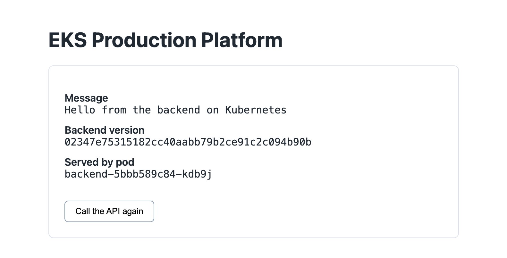
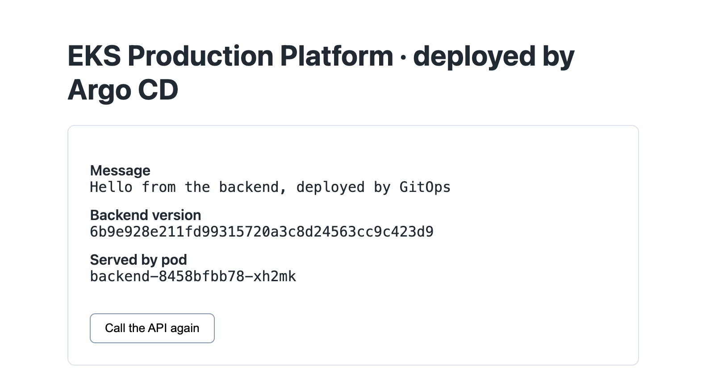
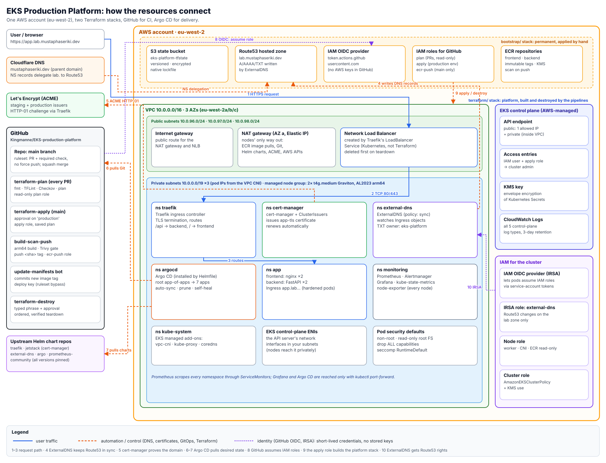
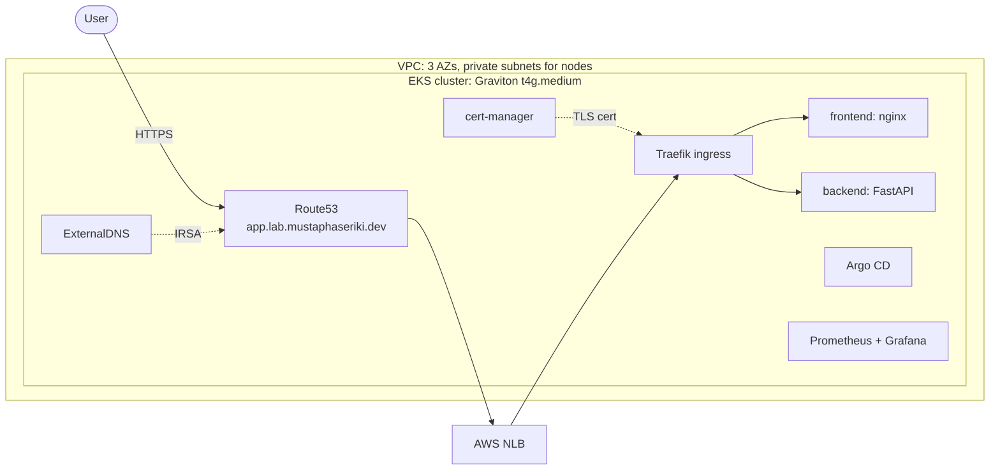
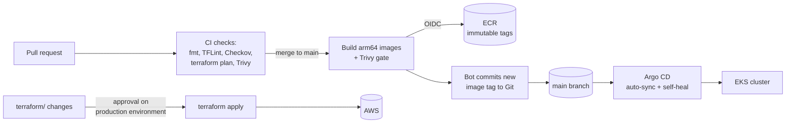
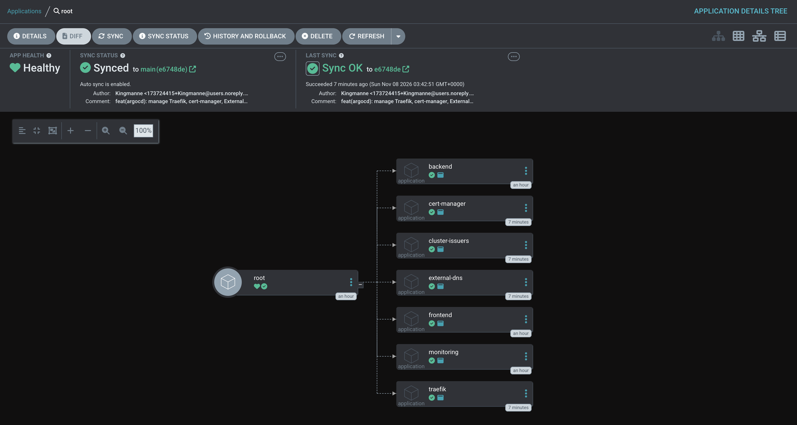
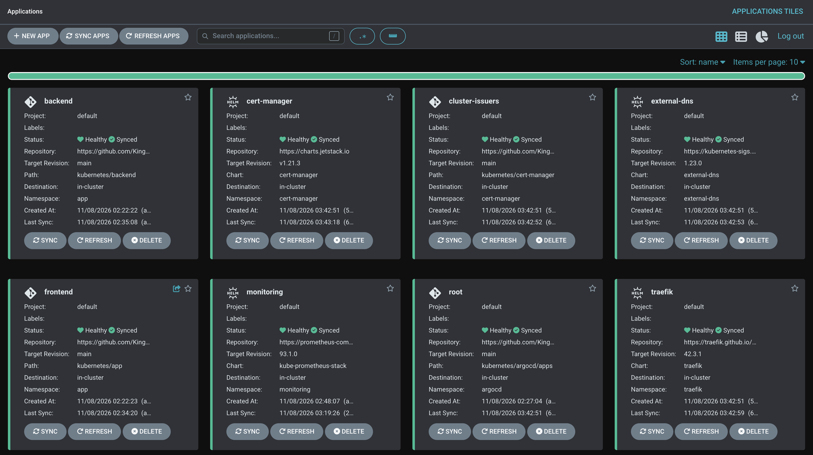
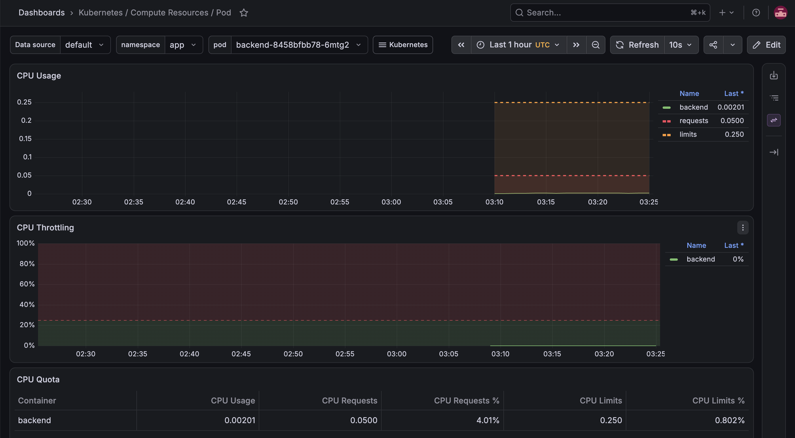
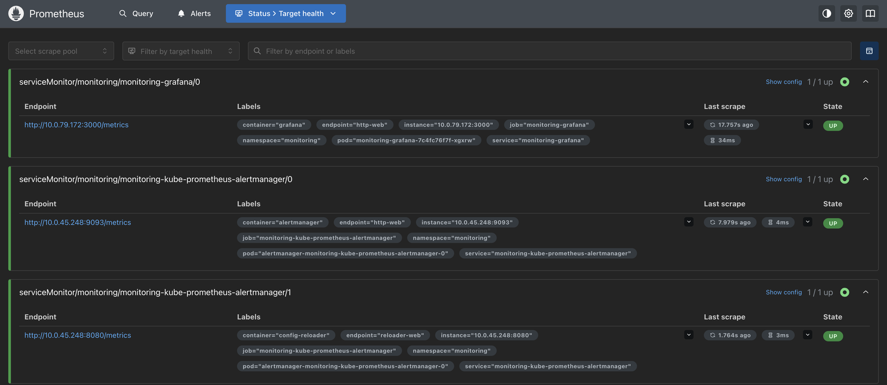
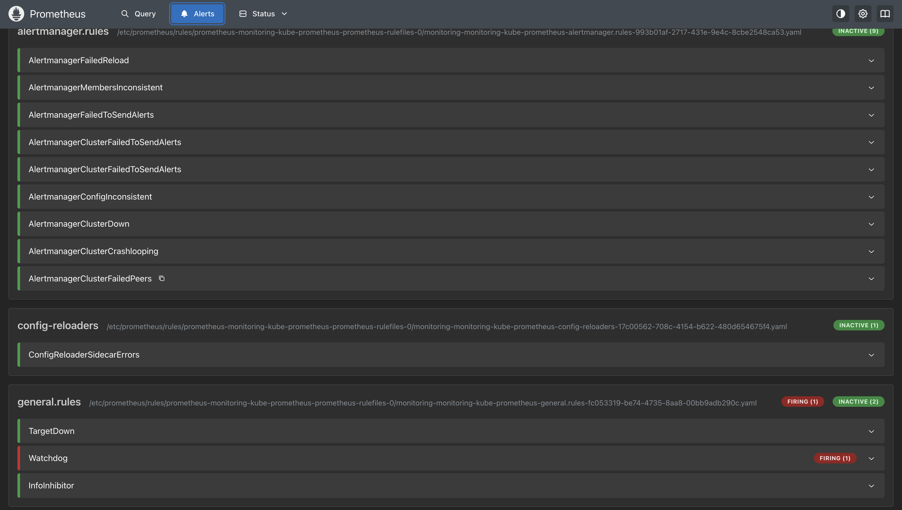

# EKS Production Platform

A production-style Kubernetes platform on AWS, built from scratch with Terraform, GitHub Actions and Argo CD. One pull request goes from code to a live HTTPS site with **no manual steps**: the image is built, scanned and pushed by CI, and Argo CD deploys it from Git.

[](https://github.com/Kingmanne/EKS-production-platform/actions/workflows/terraform-plan.yaml)
[](https://github.com/Kingmanne/EKS-production-platform/actions/workflows/build-scan-push.yaml)

| Before | After one PR (no manual steps) |
|---|---|
|  |  |

*The "after" page shows the new message, the new version (the commit SHA the image was built from) and the pod that served the request. A merged PR went through GitHub Actions (build + Trivy scan) → ECR → an automated image-tag commit → Argo CD sync → live.*

---

## Highlights

- **Infrastructure as code:** VPC, EKS (Graviton nodes, KMS-encrypted secrets, access entries) and IAM, all in Terraform modules with remote state in S3 and native lockfiles.
- **No long-lived AWS keys:** GitHub Actions authenticates to AWS with OIDC. Three least-privilege roles: plan (read-only, PRs), apply (production environment + human approval) and ECR push (main branch only).
- **Secure supply chain:** multi-stage, non-root images; Trivy blocks any fixable HIGH/CRITICAL vulnerability before push; ECR tags are immutable and scanned on push.
- **GitOps with Argo CD:** an app-of-apps manages the application, the platform add-ons and monitoring. Manual drift is reverted automatically; every change is a PR.
- **Automatic HTTPS and DNS:** Traefik behind an NLB, cert-manager (Let's Encrypt), ExternalDNS writing Route53 records through IRSA.
- **Observability:** Prometheus, Alertmanager and Grafana (kube-prometheus-stack), with a dead man's switch alert.
- **Guarded, ordered teardown:** a destroy workflow that removes Kubernetes-created AWS resources first, verifies through the AWS API, then runs `terraform destroy`.

## Architecture



*Request path (1–3), the controllers that keep DNS and certificates in sync (4–5), Argo CD pulling desired state (6–7), and the short-lived identities used by GitHub and ExternalDNS (8, 10). Full-size: [docs/images/architecture.svg](docs/images/architecture.svg).*

The same flows, simplified:





### GitOps: one root, seven Applications



Two bootstrap commands install everything: Helmfile installs Argo CD, and `kubectl apply` creates the `root` Application. After that, root manages every Application in `kubernetes/argocd/apps/` from Git:

| Application | Source | What it does |
|---|---|---|
| backend, frontend | this repo | The demo app (FastAPI API + static page), Service and Ingress |
| traefik | upstream chart 42.3.1 | Ingress controller behind an AWS NLB |
| cert-manager | upstream chart v1.21.3 | Let's Encrypt certificates |
| cluster-issuers | this repo | Let's Encrypt staging and production issuers |
| external-dns | upstream chart 1.23.0 | Route53 records from Ingress objects (IRSA) |
| monitoring | upstream chart 93.1.0 | kube-prometheus-stack |

Upstream charts are pinned to exact versions. Add-on values live in `kubernetes/helm-values/` (multi-source Applications); the monitoring values are inline in its Application.



## Tech stack

| Area | Tools |
|---|---|
| Cloud | AWS: VPC, EKS 1.37 (Graviton), ECR, Route53, KMS, IAM, S3 |
| Infrastructure as code | Terraform (modules, S3 remote state, saved plans), TFLint, Checkov |
| CI/CD | GitHub Actions (OIDC, environments, rulesets), Argo CD, Helm, Helmfile |
| Containers | Docker multi-stage builds, Trivy, ECR scan on push |
| Kubernetes add-ons | Traefik, cert-manager, ExternalDNS |
| Observability | Prometheus, Alertmanager, Grafana, kube-state-metrics, node-exporter |
| App | FastAPI (Python 3.13), nginx-unprivileged |

## Repository layout

```
bootstrap/                 Permanent stack, applied by hand: state bucket, Route53 zone,
                           GitHub OIDC provider + roles, ECR repositories
terraform/                 Platform stack, built and destroyed by the pipelines
  modules/vpc|eks|ecr      Reusable modules
  external-dns-iam.tf      IRSA role scoped to the lab zone
backend/  app/             Demo API and frontend, each with its own Dockerfile
kubernetes/
  backend/  app/           App manifests (Deployments, Services, Ingress)
  cert-manager/            ClusterIssuers
  helm-values/             Values for every Helm chart
  argocd/root.yaml         App-of-apps root (applied once)
  argocd/apps/             One Application per component
  helmfile.yaml            Bootstrap only: installs Argo CD
.github/workflows/
  terraform-plan.yaml      PRs: fmt, TFLint, Checkov, plan posted as a PR comment
  terraform-apply.yaml     main: apply after approval on the production environment
  build-scan-push.yaml     Build arm64 images, Trivy gate, push to ECR, bump image tags
  terraform-destroy.yaml   Manual, guarded, ordered teardown
```

## How a change reaches production

1. **Open a PR.** The required check runs `terraform fmt`, TFLint, Checkov and `terraform plan` (read-only role), and posts the plan as a comment. App changes are also built and scanned with Trivy.
2. **Merge to `main`.** The `main` branch is protected by a ruleset: PR required, the check must pass, no force pushes.
3. **App code:** `build-scan-push` builds the images on an arm64 runner, fails on any fixable HIGH/CRITICAL vulnerability, pushes `<service>:<commit-sha>` to ECR, and a bot commits the new tag to the manifests (`[skip ci]`, signed in with a deploy key that is allowed to bypass the ruleset).
4. **Argo CD** sees the new commit and rolls the Deployments. Readiness probes keep the old pods serving until the new ones are healthy.
5. **Infrastructure:** changes under `terraform/` run `terraform apply` on a saved plan, only after a reviewer approves the `production` environment.

Every running pod can be traced back to its source: the version the API reports is the commit SHA → the PR → its review and checks.

## Security decisions

- **OIDC instead of access keys.** Trust policies match GitHub's immutable-ID `sub` claim (`repo:<owner>@<id>/<repo>@<id>:…`), so a renamed or re-created repository cannot assume the roles.
- **Least privilege per job:** read-only for PR plans, ECR push limited to the two repositories, admin only behind a human approval.
- **EKS API endpoint restricted to one IP;** access through EKS access entries (`authentication_mode = API`), cluster-creator admin disabled. The destroy workflow adds its runner IP just in time.
- **Secrets encrypted with a customer-managed KMS key;** all five control-plane log types enabled.
- **Hardened pods:** non-root, read-only root filesystem, all capabilities dropped, seccomp `RuntimeDefault`, no privilege escalation.
- **Argo CD and Grafana are not exposed to the internet;** they are reached with `kubectl port-forward` through the authenticated API.
- **Separation of duties:** `bootstrap/` (identity, state, DNS) is applied by hand and protected with `prevent_destroy`; the pipeline cannot remove its own trust.

## Observability

| Grafana: pod CPU against request and limit | Prometheus: every target up |
|---|---|
|  |  |

- EKS control-plane scrapes (scheduler, controller-manager, etcd) are disabled because AWS does not expose them; this keeps `TargetDown` meaningful.
- `Watchdog` fires on purpose: it is a dead man's switch that proves the alerting pipeline works.
- Capacity was planned before installing: 20 of 34 pod slots used (17 per t4g.medium under the VPC CNI), 27 predicted after the install, 27 measured.



## Problems I hit and how I solved them

Real issues from building this, and what each one taught me.

| Problem | Cause | Fix |
|---|---|---|
| Certificate stuck pending for 15 minutes | cert-manager checked DNS before ExternalDNS created the record; the resolver cached "does not exist" for the SOA minimum TTL (negative caching) | Waited out the cache; backlog item to lower the zone's negative TTL. Renewals are unaffected. |
| Prometheus operator in `ImagePullBackOff`: `no match for platform in manifest` | Upstream v0.95.1 images were published amd64-only; the nodes are Graviton (arm64) | Confirmed with `docker manifest inspect`; pinned the operator and config-reloader to multi-arch v0.94.2 |
| Grafana restarting on first login | `OOMKilled` (exit 137) at a 256Mi memory limit | Read `Last State` in `kubectl describe`; raised to 256Mi request / 512Mi limit |
| Argo CD sync hanging forever | The sync waited for a Deployment that could never become healthy | Terminated the operation; the add-on Applications now have a `retry` policy with backoff |
| GitHub OIDC login refused | GitHub now sends immutable IDs in the `sub` claim | Decoded the token claims in a debug step and updated the trust policies |
| First destroy run failed at login | The workflow read `secrets.X` but the role ARN is a repository variable; an undefined reference becomes an empty string | Switched to `vars.`; the job failed before any destructive step, by design |
| Trivy findings in a "clean" image | pip's vendored libraries in the runtime image; base image lagging behind security updates | Removed pip from the runtime stage; `apt-get upgrade` / `apk upgrade` in the Dockerfiles |
| Helm add-ons moved under Argo CD with zero downtime | Recreating the Traefik Service would have replaced the NLB and broken DNS | Same chart version, values and release name, so Argo CD adopted the live resources; verified by an unchanged NLB hostname and pod ages |

## Run it yourself

**Prerequisites:** an AWS account, a domain you can delegate a subdomain from, Terraform ≥ 1.10, kubectl, Helm, Helmfile, the AWS CLI.

1. **Bootstrap (once, by hand):** `terraform -chdir=bootstrap init && terraform -chdir=bootstrap apply`. This creates the state bucket, the Route53 zone (add its NS records at your DNS provider), the GitHub OIDC roles and ECR.
2. **Set the repository variables or secrets** (`AWS_PLAN_ROLE_ARN`, `AWS_APPLY_ROLE_ARN`, `AWS_ECR_PUSH_ROLE_ARN`), the `production` environment with a required reviewer, and the `image-release` environment with the deploy key.
3. **Build the platform:** Actions → terraform-apply → Run workflow → approve.
4. **Bootstrap the cluster:**
   ```bash
   aws eks update-kubeconfig --name eks-platform --region eu-west-2
   kubectl create namespace monitoring
   kubectl -n monitoring create secret generic grafana-admin \
     --from-literal=admin-user=admin --from-literal=admin-password="$(openssl rand -base64 18)"
   helmfile -f kubernetes/helmfile.yaml apply      # installs Argo CD
   kubectl apply -f kubernetes/argocd/root.yaml    # Argo CD installs everything else
   ```
5. **Open the UIs:**
   ```bash
   kubectl -n argocd port-forward svc/argocd-server 8443:443                      # https://localhost:8443
   kubectl -n monitoring port-forward svc/monitoring-grafana 3000:80              # http://localhost:3000
   ```
6. **Tear down:** Actions → terraform-destroy → type `destroy eks-platform` → approve. `bootstrap/` is left intact.

**Cost:** about $0.25–0.30 per hour while the cluster is up (EKS control plane, two t4g.medium nodes, one NAT gateway, one NLB). Nothing in `terraform/` is meant to run when not in use; `bootstrap/` costs a few cents a month.

## What I would add next

- Persistent storage for Prometheus (EBS CSI driver) or remote write to long-term storage
- External Secrets Operator with AWS Secrets Manager instead of hand-made secrets
- SSO in front of Argo CD and Grafana
- VPC flow logs and a customer-managed KMS key for the control-plane logs
- Horizontal Pod Autoscaler and Pod Disruption Budgets for the app
- Alertmanager routing (Watchdog to an external heartbeat, critical alerts to Slack)

---

*Built step by step as a learning and portfolio project, inspired by [Param2ray/eks-production-platform](https://github.com/Param2ray/eks-production-platform).*
